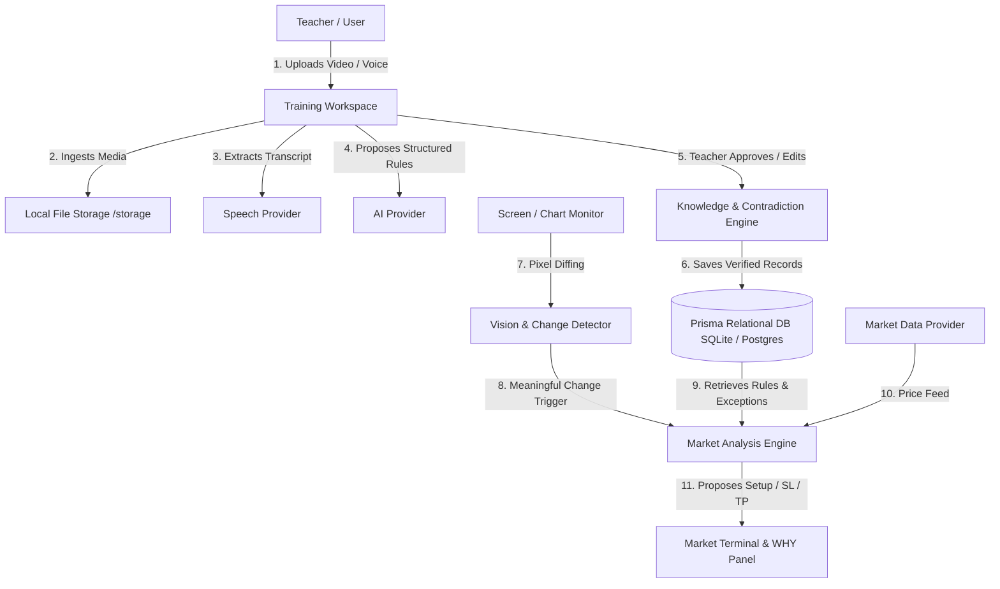

# GuardedMarketsAI Architecture

## 1. System Overview

GuardedMarketsAI is a local-first application architected around five layered subsystems:
1. **User Interface (Next.js 14+ / React / Tailwind)**: High-density dark trading terminal interface with zero decorative bloat.
2. **Knowledge Engine (Domain Service)**: Relational graph modeling concepts, rules, conditions, exceptions, and contradiction detection.
3. **Training & Video Ingestion Pipeline**: Handles video/audio upload, local storage, transcription segmentation, AI extraction, and explicit teacher review.
4. **Analysis & Replay Core**: Candlestick evaluation, screen capture monitor with pixel-diff change detection, and incremental replay simulator.
5. **Multi-Provider Abstraction Layer**: Interface contracts for `AIProvider`, `VisionProvider`, `SpeechProvider`, `EmbeddingProvider`, and `MarketDataProvider`.

---

## 2. High-Level Architecture Diagram

---

## 3. Core Principles

- **Pedagogical Student Model**: The AI does not guess or generate retail platitudes. It reasons strictly according to the teacher's approved rules and exceptions.
- **Explainability (Section 25 & 26)**: Every decision requires structured JSON output including `supporting_rules`, `conflicting_rules`, `missing_conditions`, a step-by-step `reasoning` chain, and a `what_changed` state transition diff.
- **Zero Lookahead in Replay**: The Replay Lab serves market data strictly up to index $k$, ensuring test integrity.
- **Local-First & Resilient**: Functions 100% offline out-of-the-box using the deterministic local reasoning engine and SQLite; easily scaled to PostgreSQL + pgvector for production deployments.
